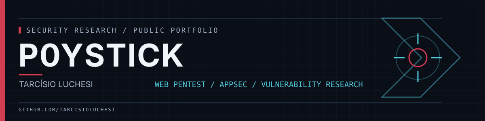

<picture>
  <source media="(prefers-color-scheme: dark)" srcset="assets/profile-banner-dark.svg">
  <source media="(prefers-color-scheme: light)" srcset="assets/profile-banner-light.svg">
  
</picture>

## Web Security Research & Proofs of Concept

> Web security research portfolio featuring vulnerability analysis, CVEs, proof-of-concepts, WordPress security research, and penetration testing methodologies.

**Tarcísio Luchesi (P0ystick)** · Web Application Security · Vulnerability Research · Penetration Testing

Independent security researcher focused on understanding how vulnerabilities arise in real web applications, especially WordPress plugins. This repository is my public technical portfolio: source-to-sink analyses, reproducible write-ups, CTF research, and proof-of-concept code designed for controlled environments.

**Career interests:** Application Security (AppSec), web penetration testing, vulnerability research, and offensive security.

## Featured contribution

### OWASP Web Security Testing Guide (WSTG)
- **[Merged contribution — OWASP/wstg #1720](https://github.com/OWASP/wstg/pull/1720)** — documented testing scenarios in which same-origin HTML Injection and XSS can undermine CSRF defenses based exclusively on the HTTP `Origin` header.
- The related research used a **local Flask laboratory** to demonstrate authenticated profile changes. Account takeover was discussed as a **conditional potential impact**, not claimed as demonstrated in the lab.

## Selected technical work

| Research / project | What it demonstrates |
| --- | --- |
| **[CVE-2025-15285 — interactive lab PoC](pocs/cve_2025_15285_interactive.py)** · [write-up](research/cve-2025-15285.html) | Python-based demonstration of missing authorization in SEO Flow by LupsOnline; the script restricts targets to local/private lab environments and asks for confirmation before state-changing actions. |
| **[Icegram Collect 1.3.21 — input-to-sink review](research/icegram-collect-1.3.21-review-url-sem-escape.md)** | WordPress/PHP static analysis of unescaped `review_url`, including prerequisite capabilities and **explicit exploitation limitations**. |
| **[Handlebars template research (CTF)](research/cve-2026-33938-handlebars-ctf.md)** | Tracing request data through an Express/Node.js template-processing flow in a controlled challenge. |
| **[Black-box newsletter consent testing](research/black-box-newsletter-consent.html)** | A practical research note on form behavior and consent-related testing hypotheses. |
| **[Paytium XSS case study](research/paytium-5-0-3-5-0-5-xss.html)** | WordPress security research and version-comparison notes. |
| **[Web testing methodology](methodology.html)** · **[WordPress methodology](wordpress-methodology.html)** | Reusable approaches to application testing and plugin analysis. |

Browse more reports and notes in **[research/](research/)**.

## Technical focus

- **Vulnerability classes:** XSS (reflected, stored, DOM), HTML Injection, CSRF, authorization/access-control issues, SQL injection, SSRF, and business-logic flaws.
- **Approaches:** black-box testing, source review, source-to-sink tracing, proof-of-concept validation, local lab reproduction, and responsible disclosure.
- **Technologies and tools:** Python, JavaScript, PHP/WordPress, HTTP, Burp Suite, browser DevTools, Git/GitHub, and Linux/WSL.

## How I document a finding

1. Identify the affected functionality, inputs, and trust boundaries.
2. Trace the relevant execution path and verify assumptions.
3. Reproduce the behavior in an authorized test environment.
4. Explain prerequisites, demonstrated impact, and limitations.
5. Share actionable evidence while respecting coordinated disclosure.

## Contact & collaboration

- **GitHub:** [@TarcisioLuchesi](https://github.com/TarcisioLuchesi)
- **Research identity:** [@P0ystick on X](https://x.com/P0ystick)
- **Areas of interest:** AppSec, pentesting, and vulnerability research.

> **Ethics and scope:** All public PoCs and write-ups are intended for education, defensive research, or systems owned by the tester / explicitly authorized for assessment. Public documentation is not permission to test third-party systems.

---

## Português

Sou **Tarcísio Luchesi (P0ystick)**, pesquisador independente de segurança de aplicações web, com foco em WordPress, análise de código, falhas de autorização, XSS e validação de vulnerabilidades em laboratório.

Este repositório reúne meu **portfólio técnico**, incluindo estudos de caso, metodologias de teste e PoCs para ambientes controlados. Minha contribuição para o **[OWASP Web Security Testing Guide foi mesclada (#1720)](https://github.com/OWASP/wstg/pull/1720)**.

**Tenho interesse em oportunidades de trabalho e colaboração em pentest web, Application Security e pesquisa de vulnerabilidades.** Meu contato profissional pode ser iniciado pelo [GitHub](https://github.com/TarcisioLuchesi) ou [X](https://x.com/P0ystick).

### Professional profile

A bilingual, recruiter-oriented [GitHub profile README](PROFILE_README_TEMPLATE.md) is ready to publish in the public `TarcisioLuchesi/TarcisioLuchesi` profile repository. The linked banners are maintained in [assets/](assets/).
